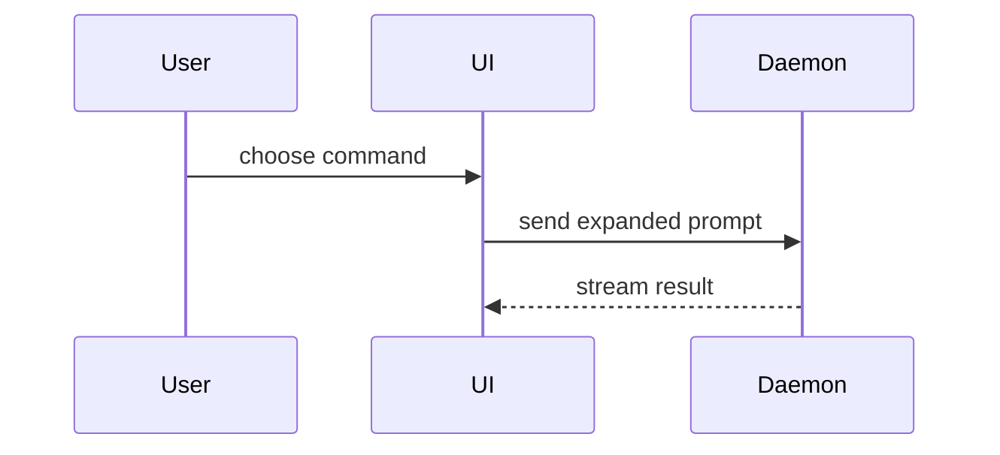

PR-ийн body-г энэ загвараар бич:

```markdown
## Хураангуй

<диаграмм, diff-ийн тойм зураг эсвэл tree>

## Нотолгоо

- **Өмнө:** <screenshot/гаралт/унасан test-ийн ажиллагаа>
  **Дараа:** <screenshot/гаралт/давсан test-ийн ажиллагаа>

## Merge-ийн эрсдэл

**Хаалга:** <нэг талын эсвэл хоёр талын>

<заавал биш: тайлбар>

**Нөлөөллийн хүрээ:** <нэг үгээр>

<заавал биш: merge хийсний дараах боломжит үр дагавар>

<заавал биш: Closes #<issue-ийн дугаар>>
```

## Хэсгүүд

Ямар ч оршил бүү бич, текстээ товч байлга. `GLOSSARY.md`-д байгаа хэрэглэгчийн domain-ий үгсийг хэрэглэ.

Repo-д PR template байвал (`.github/pull_request_template.md`, `.github/PULL_REQUEST_TEMPLATE/`, `docs/pull_request_template.md`) түүний хэсгүүдийг дагаж, энэ skill-ийн агуулгыг тэдгээрт багтаа. Тохирохгүй хэсгийг устгалгүй "Хамаарахгүй" гэж бич.

### Хураангуй

Гол санааг тодорхой болгох хамгийн жижиг дүрслэлийг сонго.

- Логик эсвэл алгоритмыг pseudocode-оор харуул:

```text
on(save)
  if content is unchanged
    return cached result
  write new content
  return fresh result
```

- Ажиллах үеийн control flow-г call tree-ээр харуул:

```text
submitForm
  createSession
    persistPrompt
    launchAgent
  navigateToSession
```

- UI-ийн бүтцийг component tree-ээр, ач холбогдолтой state ба module-ийн хилийг оруулж харуул:

```text
<SessionPage> (apps/example/src/routes/session.tsx)
  useSessionEvents()
  <SessionToolbar>
    <RunSkillButton> (packages/ui)
```

- Файлын үүрэг эсвэл өргөн хүрээний refactor-ыг гүехэн file tree-ээр харуул:

```text
src/
├── commands/       # хэрэглэгчийн үйлдлийг задлана
├── sessions/       # session-ий төлөвийг эзэмшинэ
└── transport/      # API хүсэлт илгээнэ
```

- Component-уудын харилцан үйлчлэл, control flow, data flow-г Mermaid-ээр харуул:



- Хүрээлэх бүтэц нь аль хэдийн байгаа бөгөөд гол санаа нь юу өөрчлөгдөж байгаа бол `diff` хэрэглэ. Diff-ийн хэлбэрийг сэдэвт нь тааруул.

Component-ийн өөрчлөлтөд:

```diff
 <SessionPage>
   useSessionEvents()
   <SessionToolbar>
+    <RunSkillButton />
   <SessionTimeline>
+    <SkillResultCard />
```

Файлын бүтцийн өөрчлөлтөд:

```diff
 src/
 ├── commands/
+│   └── show-me.ts       # slash command-ыг задалж өргөтгөнө
 ├── sessions/
-└── transport.ts
+└── transport/
+    ├── client.ts
+    └── stream.ts
```

Call tree эсвэл call stack-ийн өөрчлөлтөд:

```diff
 submitForm
   createSession
     persistPrompt
+    expandSkillMention
     launchAgent
-  navigateToSession
+  navigateToSession
+    subscribeToEvents
```

State эсвэл control flow-ийн өөрчлөлтөд:

```diff
 on(save)
-  write content
+  if content is unchanged
+    return cached result
+  write new content
+  invalidate cache
```

- Ихэнх нь шинэ байх, орхисон context нь эзэмшил эсвэл дарааллыг нуух, эсвэл хэрэглэгчид хуулж авах зорилтот хэлбэр хэрэгтэй үед блокийг бүтнээр нь харуул:

```ts
function expandSkill(command: string): string {
  const skillName = command.slice(1);
  return `use the ${skillName} skill`;
}
```

#### Зөвлөмж

Дүрслэл бүрийг дэмжиж буй богино текстийнх нь хажууд байрлуул. Хэрэглэгчийн одоогийн асуултад хариулах, эсвэл одоогийн хэлэлцүүлгийн асуудлыг шийдэх сонголтуудад хэрэгтэй call, файл, prop, state, хилийг л үлдээ.

Эдгээрийн нэгийг ч, хэд хэдийг нь ч хэрэглэж болно, бүгдийг нь хэрэглэх магадлал бага. Өөрөө дүгнэ, хэрэглэгчийг хэт их мэдээллээр бүү дар.

### Нотолгоо

Өөрчлөлт ажиллаж байгааг харуулах бодит нотолгоо. Өмнө ба дараахыг харуул.

Screenshot бол S зэрэглэл: орчин нь бэлэн, өөрчлөлт нь нүдэнд харагддаг бол.

Ажиллуулж гаргасан нотолгоо бол A зэрэглэл: test-ийн үр дүн, console-ийн гаралт. Өмнө нь унаж байсан, одоо давдаг яг тэр test-ийг pseudocode-оор харуул.

### Merge-ийн эрсдэл

Нэг талын эсвэл хоёр талын хаалга эсэхийг тайлбарла. Хоёр талын хаалгаар буцаж гарч болно, нэг талын хаалгаар болохгүй. Буцаахад хямд PR эрсдэл багатай. Устгах үйлдэл, буцаахад хэцүү шийдвэр агуулсан өөрчлөлт бол нэг талын хаалга.

Нөлөөллийн хүрээ (blast radius) гэдэг нь энэ PR-ийн авчирсан өөрчлөлтийн боломжит нөлөө, хамрах хүрээ. Бүх боломжийг бод. Жишээ нь layout шилжих, энэ кодыг хэрэглэдэг бусад хэсэг эвдрэх, утсан дээрх харагдац гэх мэт.

PR нь issue хааж байвал body-ийн төгсгөлд `Closes #123` гэж нэм: merge хийхэд тэр issue автоматаар хаагдана.
